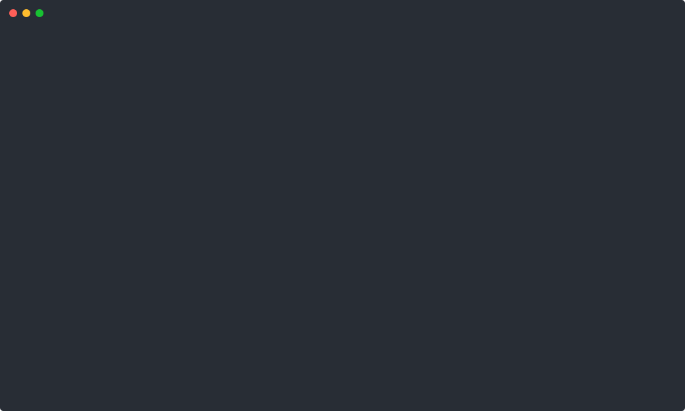

<p align="center">
  <a href="https://webcrawl.app"></a>
</p>

<h1 align="center">Webcrawl Anything</h1>

<p align="center"><strong>Give your AI agent the whole web. Free, local, no API key.</strong></p>

<p align="center">Search, scrape, map, crawl and monitor any website, SPA, PDF, YouTube video, GitHub repo, ArXiv paper, product page or CVE, from Claude Code, Cursor, Codex or your terminal.</p>

<p align="center">
  <a href="https://www.npmjs.com/package/webcrawl"></a>
  <a href="https://www.npmjs.com/package/@webcrawl/mcp"></a>
  <a href="https://www.npmjs.com/package/webcrawl"></a>
  <a href="https://skills.sh/brainfish-ai/webcrawl-anything"></a>
  <a href="https://github.com/brainfish-ai/webcrawl-anything/stargazers"></a>
  <a href="./LICENSE"></a>
</p>

<p align="center">
  
</p>

<sub>Every frame above is real output, recorded with <code>node scripts/record-demo.mjs</code>. No API key, no account.</sub>

## Set up in one line

```bash
npx skills add brainfish-ai/webcrawl-anything
```

That installs all eight Webcrawl [Agent Skills](#agent-skills-any-coding-agent) into Claude Code, Cursor, Codex, Gemini, Windsurf or any agent that reads `SKILL.md`. Only want one? Pick it by name:

```bash
npx skills add brainfish-ai/webcrawl-anything --skill webcrawl-deal-watch
```

To also register the `@webcrawl/mcp` server, so your agent can call the crawl, search and monitor tools directly:

```bash
npx webcrawl setup
```

Restart your agent and paste one of these:

```text
Is CVE-2024-3094 in anything I depend on? Look it up, give me the CVSS score, CISA KEV
status and fixed versions, then check my package-lock.json and link the evidence.
```

```text
Map https://docs.stripe.com/webhooks, crawl every page under it into Markdown, and
write me a one-page cheat sheet with the source URL under each section.
```

```text
Watch https://news.ycombinator.com every hour and alert me when a story about MCP
reaches the front page. Show me the monitor you created.
```

More reproducible prompts, each with the command it runs: **[docs/demos.md](./docs/demos.md)**.

No agent? Use the CLI directly: `npx webcrawl search "react 19 compiler"`.

---

### What You Can Crawl & Search

| Target | Returns | Requirements |
|---|---|---|
| **Websites & JS SPAs** (`web`) | Clean Markdown, semantic headings, tables, code blocks, links, OpenGraph/JSON-LD, and SHA-256 content hashes | Zero-key local (`impit` TLS impersonation + local Chrome) or [`webcrawl.app`](https://webcrawl.app) cloud stealth browsers |
| **PDF & Office Docs** (`pdf-office`) | Page-numbered Markdown, tables, slide notes, and automatic OCR on scanned PDF pages (`pagesOcr` + honest `pagesSkipped`) | Built-in PDF inspector plus `pdf-parse`, `mammoth`, `officeparser`, and `tesseract.js` |
| **YouTube & Media** (`youtube-media`) | Timestamped transcript Markdown, video title/channel/duration metadata, and spoken audio transcription | Built-in zero-key YouTube multi-client caption extractor; optional audio transcription provider for raw MP3/MP4 |
| **Shopping & Products** (`shopping`) | Multi-retailer price comparison, currency-normalized offers, stock status, ratings, review counts, and shipping | Zero-key local HTML/JSON-LD product extractor (`-c shopping`); optional `SERPER_API_KEY` |
| **Flights & Hotels** (`travel`) | Structured flight routes (`origin`, `destination`, `airline`, `stops`, `price`) and hotel nightly rates, stars, and guest ratings | Zero-key local search + schema.org extractor (`-c flights` / `-c hotels`) |
| **Real Estate & Local Business** (`real-estate`) | Property listings (`bedrooms`, `bathrooms`, `parking`, `suburb`, `portal`) and local business hours, phone, address, and reviews | Zero-key local extractor (`-c real-estate --sub buy\|rent\|sold` / `-c business`) |
| **Security & CVEs** (`cve`) | Authoritative CVE & GHSA records with CVSS v3.1/v4.0 scores, CWEs, affected/fixed package versions, and CISA KEV flags | Built-in live NVD 2.0 + OSV.dev + CISA KEV enrichment (`-c security --sub cve`) |
| **GitHub Repos, Issues & Releases** (`github`) | Structured repo metadata (stars, forks, license, topics, language), README Markdown, or issue/PR/release discussion threads | Built-in zero-key HTML & GitHub extractor (`npx webcrawl scrape https://github.com/owner/repo`) |
| **ArXiv & Academic Papers** (`arxiv`) | Paper title, authors, abstract, primary category, submission date, direct PDF link, and full parsed paper Markdown | Built-in ArXiv abstract & PDF inspector (`npx webcrawl scrape https://arxiv.org/abs/...`) |
| **llms.txt & Sitemaps** (`llms-txt`) | Structured documentation manifest, section hierarchy, and crawlable doc URLs | Built-in (`npx webcrawl scrape https://docs.example.com/llms.txt` or `npx webcrawl map`) |

Run `npx webcrawl targets` at any time to inspect all registered targets from your terminal.

---

### Quickstart

One command registers the `@webcrawl/mcp` server and installs the `webcrawl-anything` Agent Skill (`SKILL.md`) for Claude Code, Cursor, and Codex:

```bash
npx webcrawl setup
```

Or target specific coding agents:

```bash
npx webcrawl setup --agent claude --agent cursor --agent codex --agent gemini --agent windsurf
```

Check your local engine, stealth browser, and parser readiness:

```bash
npx webcrawl doctor
```

---

### Agent Skills (any coding agent)

Install webcrawl's skills into Claude Code, Cursor, Codex, or any agent that supports the [Agent Skills](https://agentskills.io/specification) spec:

```bash
npx skills add brainfish-ai/webcrawl-anything
```

Or install a single skill, for example the Black Friday price-drop watcher:

```bash
npx skills add brainfish-ai/webcrawl-anything --skill webcrawl-deal-watch
```

| Skill | What it does |
|---|---|
| **`webcrawl-ticket-watch`** | Watch StubHub/Ticketmaster/SeatGeek event pages for price drops & seat availability — get a push alert on your phone the moment tickets hit your target. |
| **`webcrawl-jobs-leads`** | Job-market intelligence: crawl company careers pages and Greenhouse/Lever boards, normalize postings, track new listings daily, rank fit. |
| **`webcrawl-deal-watch`** | Black Friday / price-drop monitor for your personal watchlist — pings your phone (free ntfy.sh push) when an item hits target price. |
| **`webcrawl-crawl`** | Any URL → clean Markdown: scrape, crawl, map, extract, categorized search. The core skill. |
| **`webcrawl-protected-sites`** | Read sites that challenge automated clients (DataDome/Cloudflare/AWS-WAF): TLS-impersonate → proxy → real-browser tier ladder, zero config to start. |
| **`webcrawl-learn-topic`** | Deep-research any topic: search → crawl authoritative sources → cited digest with a reading list. |
| **`webcrawl-research-corpus`** | Build RAG-ready Markdown corpora from docs sites: llms.txt, sitemaps, path scoping, hash dedupe. |
| **`webcrawl-real-estate`** | Search & monitor property listings with the built-in extractor — new-listing and price-reduction alerts. |

See [docs/skills.md](./docs/skills.md) for details and trigger phrases per skill.

---

### Zero-Key CLI Usage

Webcrawl Anything runs **out-of-the-box locally with zero API keys** using the built-in `impit` TLS-impersonated fetcher, document/media parsers, BM25 + semantic ranker, and vertical extractors:

```bash
# Scrape any website, GitHub repo, ArXiv paper, PDF, or YouTube video into clean Markdown
npx webcrawl scrape https://github.com/torvalds/linux
npx webcrawl scrape https://arxiv.org/abs/1706.03762
npx webcrawl scrape https://www.youtube.com/watch?v=dQw4w9WgXcQ

# Search the live web or structured verticals
npx webcrawl search "react 19 compiler" -n 5
npx webcrawl search "sony wh-1000xm5" -c shopping
npx webcrawl search "boutique hotels in shibuya" -c hotels
npx webcrawl search "3 bedroom house in marrickville" -c real-estate --sub buy
npx webcrawl search "CVE-2024-3094 xz utils" -c security --sub cve

# Discover every URL on a domain (sitemap.xml + robots.txt + link graph)
npx webcrawl map https://docs.stripe.com --filter webhook -n 50

# Crawl up to 25 pages in parallel with target evidence
npx webcrawl crawl https://docs.stripe.com/webhooks -n 5

# Extract structured JSON from any page
npx webcrawl extract https://news.ycombinator.com --prompt "top 5 stories with points"
```

---

### Example Prompts (Once Connected to Your Agent)

Once `npx webcrawl setup` has registered the MCP server and skill, ask Claude Code, Cursor, or Codex directly:

- *"Search for CVE-2024-3094 in the security category and show me the CVSS score, CISA KEV status, and fixed versions."*
- *"Scrape `https://arxiv.org/abs/2305.18290` and summarize the DPO objective and experimental results."*
- *"Compare retail prices and stock availability for the Apple Mac Mini M4 across US retailers using `web_search` with `category: shopping`."*
- *"Map `https://modelcontextprotocol.io`, pick the specification pages, and crawl them into Markdown."*
- *"Parse the PDF at `https://www.w3.org/WAI/ER/tests/xhtml/testfiles/resources/pdf/dummy.pdf` and verify whether any pages required OCR."*

---

### Local Engine vs. [`webcrawl.app`](https://webcrawl.app) Cloud

Webcrawl Anything uses the **exact same TypeScript engine (`src/`)** locally and in the hosted [`webcrawl.app`](https://webcrawl.app) cloud API. You can start with zero keys locally and upgrade to cloud with one command whenever you need managed browsers or sub-50ms global cache hits:

| Capability | Open-Source Local (`--mode local`) | [`webcrawl.app`](https://webcrawl.app) Cloud (`--mode cloud`) |
|---|---|---|
| **API Key Required** | **None (Zero-Key)** | `WEBCRAWL_API_KEY` (`npx webcrawl login`) |
| **Core Engine & Target Plugins** | 100% shared (`src/engine`, `src/targets`, `src/extract`) | 100% shared |
| **PDF, Office, YouTube & CVE Parsers** | Built-in local execution | Hosted + background async workers (`/v1/runs/:id`) |
| **JavaScript-heavy pages** | Local `impit` TLS + local Chrome | Managed browser fleet + Cloudflare rendering |
| **Search Fan-Out** | Built-in DuckDuckGo/Bing plus optional API keys | Managed multi-provider fan-out |
| **Global Content Cache** | Local in-memory LRU | Sub-50ms global SHA-256 content-addressed cache |

### How the engine works

Static pages never launch Chrome. JavaScript pages use a CDP-driven local Chrome session with a readiness wait, a hard timeout, and fallback flags. If rendering cannot happen, the scrape is `success: false` (`needsJs`). Extract strips script and style tags and supports nested schemas. Search fans out across keyless sources and fills up to `n`. See [docs/engine.md](./docs/engine.md).

To connect your CLI and MCP server to [`webcrawl.app`](https://webcrawl.app) cloud:

```bash
npx webcrawl login
npx webcrawl whoami
```

---

### Compact MCP Schema Profile for Context-Constrained Agents

By default, `npx webcrawl setup` configures `WEBCRAWL_MCP_SCHEMA_PROFILE=compact` so MCP tool schemas use minimal token overhead inside Claude Code, Cursor, and local LLM context windows while keeping full server-side validation.

To switch to verbose tool parameter descriptions:

```bash
npx webcrawl setup --schema-profile full
```

---

### Architecture & Shared Engine Flywheel

```text
webcrawl/
├── src/
│   ├── targets/        # Pluggable Target & Extractor Registry (web, pdf-office, youtube, github, arxiv, llms-txt, shopping, travel, real-estate, cve)
│   ├── engine/         # Multi-tier fetcher (impit TLS impersonation → stealth browser → HTML-to-Markdown + SHA-256 cache)
│   ├── parse/          # Native PDF inspector + OCR fallback, DOCX/XLSX/PPTX parser, YouTube caption extractor
│   ├── extract/        # Vertical structured extractors (shopping, flights, hotels, real-estate, business, CVE/NVD/OSV)
│   ├── search/         # Multi-provider search fan-out + vertical pipelines
│   ├── ranker/         # Hybrid BM25 + semantic vector + RRF + MMR diversity reranker
│   └── local-engine.ts # In-process zero-key backend powering CLI & MCP locally
├── packages/
│   ├── cli/            # `webcrawl` CLI (`npx webcrawl search|scrape|map|crawl|extract|rerank|targets|setup|doctor`)
│   ├── mcp/            # `@webcrawl/mcp` stdio & Streamable HTTP MCP server
│   └── client/         # `@webcrawl/client` zero-dependency TypeScript SDK
└── api/
    └── index.ts        # Production `webcrawl.app` API powered by the exact same `src/` engine
```

Every community improvement to a target plugin (`src/targets/`), vertical extractor (`src/extract/`), or document parser (`src/parse/`) immediately powers both local CLI/MCP users and the hosted [`webcrawl.app`](https://webcrawl.app) platform.

---

### Show your build

Built something with webcrawl, like a price tracker, a docs corpus, a research agent, or a monitor that saved you a refresh? Open a [Show your build](https://github.com/brainfish-ai/webcrawl-anything/discussions/categories/show-and-tell) discussion with the prompt you used and a screenshot. We feature the best ones here and in release notes.

Add the badge to your project:

```markdown
[](https://github.com/brainfish-ai/webcrawl-anything)
```

---

### Contributing a New Target or Extractor

Want to add a new target (e.g., Reddit threads, Hacker News discussions, SEC EDGAR filings, npm/PyPI packages, or a regional real-estate/shopping portal)?

See **[CONTRIBUTING.md](./CONTRIBUTING.md)** for the 3-step guide to registering a `CrawlTargetPlugin` in `src/targets/` with a fixture test in `src/__tests__/targets.test.ts`.

New here? Start with a [good first issue](https://github.com/brainfish-ai/webcrawl-anything/issues?q=is%3Aopen+label%3A%22good+first+issue%22) or a [target plugin request](https://github.com/brainfish-ai/webcrawl-anything/issues?q=is%3Aopen+label%3Atarget-plugin).

### Contributors

Every merged PR is credited by name in the release notes.

[](https://github.com/brainfish-ai/webcrawl-anything/graphs/contributors)

---

### License

MIT
