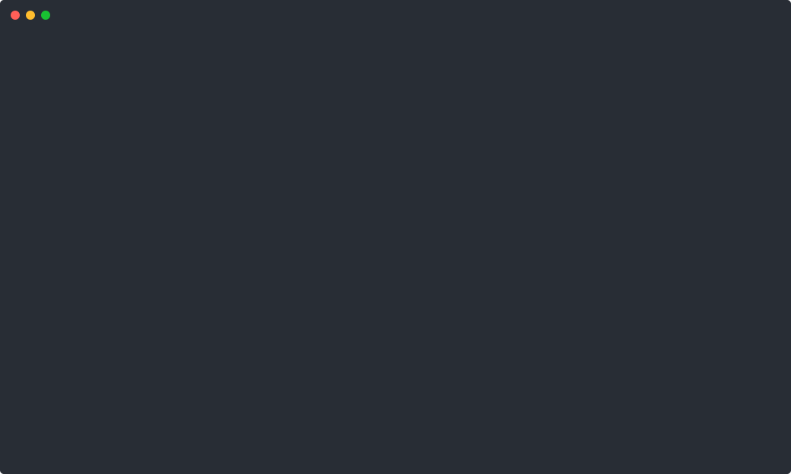

# Demo prompts

Copy-paste prompts for Claude Code, Cursor or Codex after `npx webcrawl setup`. Each one lists the CLI command the agent ends up running, so you can check the evidence yourself without an agent.

Everything here runs **locally with no API key**. Each demo was run against the live sites on 2026-11-03 with `--mode local`. Sites change, so if one stops working, [open an issue](https://github.com/brainfish-ai/webcrawl-anything/issues/new) with the output.

| # | Demo | What the viewer sees | Local time |
|---|---|---|---|
| 1 | [Is this CVE in my dependencies?](#1-is-this-cve-in-my-dependencies) | CVSS 10, KEV status, fixed versions, then a verdict on your lockfile | ~1s |
| 2 | [Docs site to cheat sheet](#2-docs-site-to-cheat-sheet) | A docs section mapped, crawled and condensed with source links | ~3s |
| 3 | [Tell me when it hits the front page](#3-tell-me-when-it-hits-the-front-page) | A live monitor with a trigger rule, checked every hour | ~1s |
| 4 | [Explain a repo before I clone it](#4-explain-a-repo-before-i-clone-it) | Stars, license, language and README summary of any GitHub repo | <1s |
| 5 | [Read a paper for me](#5-read-a-paper-for-me) | Title, authors, abstract and key results from an arXiv page | <1s |
| 6 | [What changed this year, with sources](#6-what-changed-this-year-with-sources) | A cited digest, every claim linked | ~1s per search |
| 7 | [Turn a docs site into a RAG corpus](#7-turn-a-docs-site-into-a-rag-corpus) | Every URL of a docs site, deduped Markdown files on disk | ~1s map |

---

## 1. Is this CVE in my dependencies?



```text
Is CVE-2024-3094 in anything I depend on? Look it up, give me the CVSS score, CISA KEV
status and fixed versions, then check my package-lock.json and link the evidence.
```

Under the hood:

```bash
npx webcrawl search "CVE-2024-3094 xz utils" -c security --sub cve -n 2
```

Expected: `CVE-2024-3094 … 10 critical nvd` with the NVD link, then corroborating sources.

**Clip (30s):** open a real project, paste the prompt, cut to the CVSS line, end on the agent's "not affected / affected" verdict with the link.

## 2. Docs site to cheat sheet


```text
Map https://docs.stripe.com/webhooks, crawl every page under it into Markdown, and
write me a one-page cheat sheet with the source URL under each section.
```

Under the hood:

```bash
npx webcrawl map https://docs.stripe.com/webhooks -n 10
npx webcrawl crawl https://docs.stripe.com/webhooks -n 5
```

Expected: `/webhooks`, `/webhooks/quickstart`, `/webhooks/versioning`, … then clean Markdown with headings for each page.

**Clip (45s):** show the list of URLs, then the finished cheat sheet, then click a source link to show it is real.

## 3. Tell me when it hits the front page

```text
Watch https://news.ycombinator.com every hour and alert me when a story about MCP
reaches the front page. Show me the monitor you created.
```

Under the hood:

```bash
npx webcrawl monitor create https://news.ycombinator.com \
  --condition 'content contains "MCP"' --watch-for "MCP stories" --interval 60
npx webcrawl monitor list
```

Expected: a monitor id with `rule: content contains "MCP"` and a `waiting` or `triggered` state.

**Clip (30s):** create the monitor, show `monitor list`, then show the alert landing (use `--webhook` to an ntfy.sh topic for a phone notification). Delete it afterwards with `npx webcrawl monitor delete <id>`.

## 4. Explain a repo before I clone it


```text
Before I clone https://github.com/torvalds/linux, tell me what it is, its license,
how active it is, and how the README says to build it.
```

Under the hood:

```bash
npx webcrawl scrape https://github.com/torvalds/linux
```

**Clip (20s):** paste a repo URL someone just posted on X and get the summary back.

## 5. Read a paper for me


```text
Read https://arxiv.org/abs/1706.03762 and give me the problem, the method, the headline
results with numbers, and one limitation, quoting the abstract as evidence.
```

Under the hood:

```bash
npx webcrawl scrape https://arxiv.org/abs/1706.03762
```

Expected: title, all 8 authors, the abstract (28.4 BLEU on WMT 2014 EN-DE, 41.8 on EN-FR).

Use the `/abs/` page. Direct `/pdf/` links are not reliable in local mode yet.

## 6. What changed this year, with sources


```text
What changed in the Model Context Protocol spec in 2026? Search, read the primary
sources, and give me a dated list of changes with a link under every item.
```

Under the hood:

```bash
npx webcrawl search "model context protocol spec changes 2026" -n 5
npx webcrawl scrape https://modelcontextprotocol.io/specification/2026-07-28/changelog
```

**Clip (45s):** the payoff is the links. Click two of them on camera.

## 7. Turn a docs site into a RAG corpus


```text
Map https://react.dev, crawl the /learn section into one Markdown file per page under
./corpus/react, and tell me how many pages and words you saved.
```

Under the hood:

```bash
npx webcrawl map https://react.dev -n 50
npx webcrawl crawl https://react.dev/learn -n 25
```

---

## Recording checklist

- Record at 1280×720 or larger, with a dark terminal theme and font size 18 or bigger.
- Start the clip on the prompt, not the setup. Put setup (`npx webcrawl setup`) in the caption.
- Show evidence on screen, like a link, a number, or a file on disk. "Prove it" is what makes clips shareable.
- Keep it under 60 seconds and cut the waiting.
- Caption template: `<outcome> with one prompt. Free, local, no API key. npx webcrawl setup · github.com/brainfish-ai/webcrawl-anything`

## Re-recording the README animation

```bash
npm run build
node scripts/record-demo.mjs
npx svg-term-cli --in docs/assets/demo.cast --out docs/assets/demo.svg --window --no-cursor --width 100 --height 26
```
